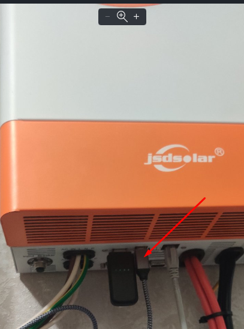

# Інтеграція JSDSolar J5500HPC/J5500HP для Home Assistant

**Інвертор JSD SOLAR** · активний балансир JK-DZ11-B2A24S · BMS батарей Pace / JK / TDT

[English](../../README.md) | [Deutsch](../de/README.md)

> **Примітка**: це форк [fancyui/Gobel-Battery-HA-Integration](https://github.com/fancyui/Gobel-Battery-HA-Integration) з доданою підтримкою інверторів JSD SOLAR J5500HPC/J5500HP і балансира JK-DZ11-B2A24S.

Нативна custom-інтеграція Home Assistant для **інверторів JSD SOLAR J5500HPC/J5500HP**. Вона обмінюється даними з інвертором через RS232 (напряму або через міст WiFi/Ethernet), показує все, що повідомляє інвертор, як сутності Home Assistant і за бажанням змінює його налаштування, зокрема з автоматизацій. Та сама інтеграція підтримує також активний балансир JK-DZ11-B2A24S і LiFePO4-батареї з BMS Pace, JK або TDT.

Інтеграція **не потребує MQTT-брокера**: пристрої та сутності створюються прямо в Home Assistant і налаштовуються через інтерфейс. Кілька пристроїв (наприклад, інвертор, балансир і батарейний банк) додаються окремими записами.

---

## Основні можливості:

### Інвертор JSD SOLAR (J5500HPC/J5500HP)
* **Моніторинг:** мережа, вихід, інверторний каскад, DC-шина, батарея, PV, температури, вентилятори, лічильники енергії, дані BMS, які бачить інвертор, аварії та попередження, знімок останньої аварії, паралельні юніти.
* **Керування (опційно):** кожне налаштування як сутність `number`/`select` (напруги батареї — повзунки з кроком 0,1 В), функціональні прапорці як перемикачі, кнопки увімкнення/вимкнення, скидання лічильників енергії та синхронізації годинника. Кожен запис перевіряється на діапазон, підтверджується інвертором (`ACK`, з повтором при `NAK`) і читається назад.
* **Автоматизації:** дії для надсилання будь-якої команди з отриманням відповіді та для негайного перечитування вибраних сутностей без очікування циклу опитування.
* **Синхронізація годинника (опційно):** тримає дату й час інвертора рівними часу Home Assistant.
* **Діагностика:** логування трьох рівнів глибини, аж до кожного кадру на лінії з часом відповіді.

### Активний балансир JK-DZ11-B2A24S
* Напруги комірок, струм і стан балансування, температура, тривоги через RS485; опційне керування кількістю комірок, порогом різниці, максимальним струмом і вмиканням балансування.

### BMS батарей
* **Pace BMS** (RS232/RS485/WiFi), **JK BMS** (пасивний протокол 55AA) і **TDT BMS** (RS232): напруги комірок, ємність, струм, температури, аварії.
* **Групування паків:** загальні показники (загальний SOC, напруга, струм) на батьківському пристрої та дочірній пристрій для кожного паралельно підключеного slave-пака.

### Загальне
* **Підключення:** RS232-USB, RS485-USB або міст RS232/RS485-Ethernet/WiFi.
* **Налаштування через GUI (Config Flow):** усе додається й налаштовується в **Пристрої та служби**, без YAML.

---

## Підключення інвертора JSD SOLAR (наприклад, J5500HPC):


<p> </p>

- **Потрібен кабель RS232-USB або міст RS232-WiFi/Ethernet** (наприклад, ESP8266 з ESPHome `stream_server` або модуль USR/Elfin у режимі прозорого TCP).
- **Порт підключення**: роз'єм **RS232** DB9 на інверторі: контакт 2 = TX інвертора, контакт 3 = RX інвертора, контакт 5 = GND.
- **Параметри порту**: **2400 бод, 8N1**. Оберіть тип `JSD_SOLAR`; на кроці serial буде запропоновано 2400 бод. Міст теж має бути налаштований на 2400 8N1.
- **Інтервал опитування**: за один цикл зчитується близько 15 ASCII-кадрів, що на 2400 бод займає приблизно 5 с. Рекомендований інтервал опитування — **10 с або більше**; змінити його можна пізніше в **Налаштувати** (Configure), як і послідовний порт, швидкість або IP/порт моста.
- Інвертор працює за власним ASCII-протоколом JSD ([protocol.JSDSOLAR.uk.md](../protocols/protocol.JSDSOLAR.uk.md)), а не за PI30/PI18 (Voltronic), тому інтеграції на кшталт `pipsolar` з ним не працюють.
- **Керування (опційно)**: за замовчуванням інтеграція лише читає дані. Щоб змінювати налаштування, відкрийте інтеграцію, натисніть **Налаштувати** (Configure) і ввімкніть **Увімкнути керування інвертором**. З'являться entities `number`/`select` для всіх налаштувань, перемикачі для функціональних прапорців і кнопки: увімкнення/вимкнення, скидання лічильників енергії, скидання до заводських налаштувань, синхронізація годинника. Кожне значення перевіряється на допустимий діапазон, інвертор має підтвердити запис (`ACK`; при `NAK` або без відповіді — до 5 спроб з паузою 1 с), після чого значення зчитується назад. Налаштування напруги батареї — повзунки з кроком 0,1 В. Кнопки **Power Off**, **Reset Energy Counters** і **Factory Reset** спочатку вимкнені: увімкніть їх у налаштуваннях entity, якщо вони потрібні. Частину налаштувань інвертор приймає лише в певних режимах роботи; відхилений запис Home Assistant покаже як помилку.
- **Логування для налагодження**: у **Налаштувати** ввімкніть **Увімкнути логування** і виберіть **Глибину логування**: *Базовий* (підсумок циклу, ідентифікація, записи), *Протокол* (+ кожен кадр, надісланий інвертору й отриманий від нього, із часом відповіді) або *Протокол + парсинг* (+ розібрані значення кожної команди). Записи з'являються в **Налаштування → Система → Журнали**. Після налагодження вимкніть: глибокі рівні пишуть багато.
- **Синхронізація годинника (опційно)**: коли керування увімкнене, **Налаштувати → Синхронізувати дату й час інвертора** після кожного зчитування дати/часу звіряє годинник інвертора з Home Assistant і виправляє розбіжність понад 30 с (не частіше ніж раз на годину).
- **Дії для автоматизацій**: надсилання сирих команд і оновлення сутностей на вимогу, див. [JSD SOLAR: команди й оновлення в автоматизаціях](#jsd-solar-команди-й-оновлення-в-автоматизаціях).
- Команди калібрування не підтримуються.

---

## JSD SOLAR: команди й оновлення в автоматизаціях

Інтеграція додає для інвертора дві дії. Обидві є в **Інструменти розробника → Дії** та в редакторі автоматизацій (**Додати дію → JSDSolar J5500HPC/J5500HP**), тож їх можна спробувати, перш ніж додавати в автоматизацію.

### Перед початком

- Читання (запити) працює без жодних опцій.
- Для команд запису потрібно **Налаштувати → Увімкнути керування інвертором**.
- Щоб бачити кадри на лінії, увімкніть **Увімкнути логування** з глибиною *Протокол* (див. вище).
- Синтаксис команд — у [protocol.JSDSOLAR.uk.md](../protocols/protocol.JSDSOLAR.uk.md). Команду надсилайте без завершального CR.

### Надіслати команду: `jsdsolar_j5500hpc_j5500hp.send_command`

| Поле | Обов'язкове | Значення |
|---|---|---|
| `command` | так | Текст команди, наприклад `GBAT`, `CPR??`, `CPR03` |
| `attempts` | ні, за замовчуванням 1 | Повторювати до стількох разів (1–10), поки інвертор відповідає `NAK` або мовчить |
| `device_id` | лише якщо інверторів кілька | Пристрій-інвертор |

Спробуйте в **Інструменти розробника → Дії**: виберіть *Надіслати команду інвертору*, перейдіть у режим YAML, вставте

```yaml
action: jsdsolar_j5500hpc_j5500hp.send_command
data:
  command: GBAT
```

і натисніть **Виконати дію**. Відповідь з'явиться нижче:

```yaml
command: GBAT
response: (052.4 031.50 16 42.0 44.0
status: ok
attempts: 1
elapsed_ms: 412
parsed:
  battery_voltage: 52.4
  battery_discharge_current: 31.5
  setting_battery_cells: 16
  setting_battery_cutoff_voltage: 42
  setting_battery_warning_voltage: 44
```

| `status` | Значення |
|---|---|
| `ok` | Інвертор надіслав дані (відповідь на запит) |
| `ack` | Інвертор прийняв запис |
| `nak` | Інвертор відхилив команду: поза діапазоном, не дозволено в поточному режимі або невідома команда |
| `no_answer` | Немає відповіді за 3 с на кожну спробу |

`parsed` є лише для запитів, які інтеграція знає (швидкий набір, `I`/`SVFW`/`F`, зворотне читання налаштувань на кшталт `CPR??`, `TE?`, `DATE??????`, `TIME??????`, `TCQN????`, `GFAIL`, `GCF`).

Що можна надсилати:

- **Запити** дозволені завжди: усе, що містить `?` (`CPR??`, `GCC???`, `BTB????`, `TE?`), і команди-запити протоколу (`GMOD`, `GBAT`, `GPV`, `GOP`, `GLINE`, `BL`, `GWS`, `I`, `F`, `GPDAT1` …).
- **Усе інше — запис** (`CPR03`, `OPR01`, `GCC030`, `TEO`, `TDO`, `SON` …), для нього потрібне керування інвертором. Запис логується на рівні INFO.
- **Команди калібрування** (§10: `BA0`, `B1A…`, `B2A…`, `PA0`, `PV<nnn.n>`, `BUN±`, `VR±` …) відхиляються завжди.

`send_command` не оновлює сутності. Після нього викличте `refresh` (нижче).

Типові команди:

| Призначення | Запит | Запис |
|---|---|---|
| Пріоритет зарядки (0 мережа, 1 PV, 2 мережа і PV, 3 лише PV) | `CPR??` | `CPR00` … `CPR03` |
| Пріоритет виходу (0 мережа, 1 PV, 2 PV-батарея-мережа) | `OPR??` | `OPR00` … `OPR02` |
| Макс. струм зарядки від мережі, А | `GCC???` | `GCC030` (3 цифри) |
| Напруга батареї для переходу на мережу | `BTG????` | `BTG47.5` (`nn.n`) |
| Функціональні прапорці | `TE?` (увімкнені літери) | `TE<літера>` увімк., `TD<літера>` вимк. |
| Дата / час | `DATE??????`, `TIME??????` | `DATE251203`, `TIME051203` |

Для налаштувань, які мають сутність, простіше `select.select_option` і `number.set_value`: вони самі перевіряють діапазон, роблять до 5 спроб і читають значення назад.

### Оновити сутності зараз: `jsdsolar_j5500hpc_j5500hp.refresh`

Вимірювання інтеграція опитує приблизно кожні 5 с, а налаштування, прапорці, годинник і знімок аварії йдуть через повільну чергу (3 команди за цикл), тож налаштування може оновлюватися кілька хвилин. `refresh` одразу перечитує лише ті команди, з яких беруться вибрані сутності (`battery_voltage` → `GBAT`, `setting_charger_priority` → `CPR??`, перемикач прапорця → `TE?`), оновлює ці сутності й повертає свіжі значення:

```yaml
action: jsdsolar_j5500hpc_j5500hp.refresh
target:
  entity_id:
    - select.j5500hpc_setting_charger_priority
    - sensor.j5500hpc_battery_voltage
```

Відповідь:

```yaml
values:
  select.j5500hpc_setting_charger_priority: PV only
  sensor.j5500hpc_battery_voltage: 52.4
```

Сутності з однієї команди коштують один запит. Сутність, яку інтеграція ще не прочитала (одразу після перезапуску), дає помилку; дочекайтеся перших циклів опитування.

Стандартна дія **`homeassistant.update_entity`** для сутності інвертора робить те саме точкове перечитування, але без відповіді.

### Приклади

Перемкнути пріоритет зарядки сирою командою, перевірити відповідь і оновити сутність:

```yaml
actions:
  - action: jsdsolar_j5500hpc_j5500hp.send_command
    data:
      command: CPR03
      attempts: 5
    response_variable: reply
  - if:
      - condition: template
        value_template: "{{ reply.status != 'ack' }}"
    then:
      - action: persistent_notification.create
        data:
          message: "Інвертор не прийняв CPR03: {{ reply.status }} після {{ reply.attempts }} спроб"
      - stop: "CPR03 не прийнято"
  - action: jsdsolar_j5500hpc_j5500hp.refresh
    target:
      entity_id: select.j5500hpc_setting_charger_priority
```

Прочитати свіже значення безпосередньо перед рішенням:

```yaml
actions:
  - action: jsdsolar_j5500hpc_j5500hp.refresh
    target:
      entity_id: sensor.j5500hpc_battery_voltage
    response_variable: fresh
  - if:
      - condition: template
        value_template: "{{ fresh['values']['sensor.j5500hpc_battery_voltage'] | float(0) < 48 }}"
    then:
      - action: select.select_option
        target:
          entity_id: select.j5500hpc_setting_output_priority
        data:
          option: Grid first
```

Використати відповідь запиту, для якого немає сутності:

```yaml
actions:
  - action: jsdsolar_j5500hpc_j5500hp.send_command
    data:
      command: GCF
    response_variable: gcf
  - action: persistent_notification.create
    data:
      message: "GCF: {{ gcf.response }}"
```

### Помилки

Дія завершується помилкою (і автоматизація зупиняється, якщо в кроці немає `continue_on_error: true`), коли команда — запис, а керування інвертором вимкнене; коли це команда калібрування; коли ціль — не сутність інвертора JSD SOLAR; або коли сутність для оновлення ще не прочитана. Відповідь `nak` чи `no_answer` — не помилка: перевіряйте `status`.

---

## Підключення активного балансира JK-DZ11-B2A24S (RS485):


- **Кабель RS485-USB або міст RS485-Ethernet/WiFi**, підключений до порту RS485 балансира (A до A, B до B). Позначення A/B у виробників різняться: якщо балансир не відповідає або в журналі налагодження видно лише коротку відповідь `55 95 01 FF 01`, поміняйте A і B місцями.
- **Тип пристрою**: `JK_BALANCER`. Це інший протокол, ніж `JK_PB`: балансир лише відповідає на запити й сам нічого не надсилає, тому запис типу `JK_PB` з ним лишається недоступним.
- **Параметри порту**: **9600 бод, 8N1** (крок serial пропонує 9600). Міст треба налаштувати так само.
- **Адреса**: RS485-адреса slave балансира, за замовчуванням 1; змінити її можна в **Налаштувати** (Configure).
- **Керування (опційно)**: у **Налаштувати** ввімкніть **Увімкнути керування балансиром**, щоб змінювати кількість комірок (2–24), поріг різниці напруг для балансування (2–1000 мВ), максимальний струм балансування (30–2000 мА на моделі на 2 А) і вмикати/вимикати балансування.
- **Недоступно через RS485**: опори проводів комірок і «напруга початку балансування»; балансир передає їх лише через Bluetooth у додатку JK.
- Протокол: [JK-DZ11B2A224S_RS485_V1.3_uk.md](../protocols/JK-DZ11B2A224S_RS485_V1.3_uk.md).

---

## Підключення Pace BMS:
- **Потрібен модуль RS232-WIFI/Ethernet або кабель RS232-USB**
- **Порт підключення**: підключіть Home Assistant до інтерфейсу **RS232** або **WIFI** на Pace BMS.
- **Master BMS**: підключення має бути саме до **master BMS**.
- **DIP-перемикачі**: переконайтеся, що DIP-перемикачі (адреса) master BMS встановлені в **1000**.
- **Роздільність струму**: більшість PACE BMS передають струм у 0,01 А. Якщо струм і потужність у 10 разів менші за реальні, виберіть **Налаштувати → Роздільність струму PACE** = 0,1 А.

## Підключення JK BMS:
- **Потрібен модуль RS485-WIFI/Ethernet або кабель RS485-USB**
- **Порт підключення**: підключіть Home Assistant до інтерфейсу **RS485B** або **RS485C** на JK BMS.
- **Master BMS**: підключення має бути саме до **master BMS**.
- **DIP-перемикачі**: переконайтеся, що DIP-перемикачі (адреса) master BMS встановлені в **0000**.

---

## Встановлення:

### Варіант 1: через HACS (рекомендовано)
1. Переконайтеся, що [HACS (Home Assistant Community Store)](https://hacs.xyz/) встановлено.
2. У Home Assistant перейдіть до **HACS -> Інтеграції**.
3. Натисніть три крапки у верхньому правому куті та оберіть **Користувацькі репозиторії** (Custom repositories).
4. Вставте URL цього репозиторію: `https://github.com/NewBotanik/J5500HPC-HA-Integration`
5. Оберіть категорію **Integration** і натисніть **Додати**.
6. Знайдіть у HACS інтеграцію **JSDSolar J5500HPC/J5500HP** і натисніть **Завантажити**.
7. Перезапустіть Home Assistant.

### Варіант 2: встановлення вручну
1. Завантажте останній реліз (zip-архів) або клонуйте репозиторій.
2. Скопіюйте каталог `custom_components/jsdsolar_j5500hpc_j5500hp` до каталогу `/config/custom_components/` вашого Home Assistant.
3. Перезапустіть Home Assistant.

---

## Налаштування:
1. У Home Assistant перейдіть до **Налаштування -> Пристрої та служби**.
2. Натисніть **Додати інтеграцію** в нижньому правому куті.
3. Знайдіть **JSDSolar J5500HPC/J5500HP** і натисніть на неї.
4. Оберіть тип пристрою (інвертор JSD SOLAR, балансир JK або BMS) і підключення (мережа чи послідовний порт). Наступний крок питає лише те, що потрібно цьому типу: для інвертора й балансира — тільки назву пристрою та інтервал опитування; для BMS — ще тип порту, макс. кількість паралельних паків і нумерацію паків JK. Далі введіть IP/порт моста або послідовний порт і швидкість.
5. Якщо у вас кілька батарейних банків або інверторів з різними IP-адресами чи портами, просто знову натисніть **Додати інтеграцію**, щоб налаштувати ще один екземпляр.
